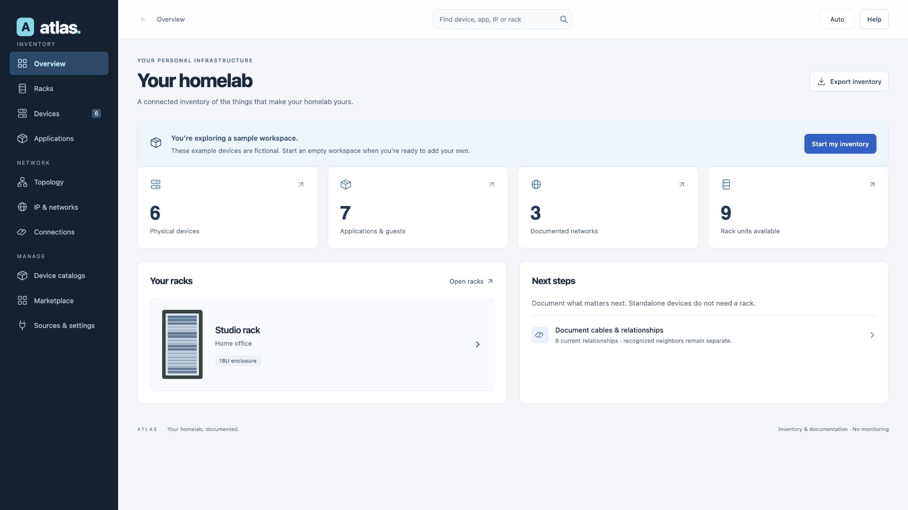

# Atlas

**Your homelab, documented.**

[](LICENSE)
[](https://github.com/42bios/atlas/releases)

Atlas is a self-hosted inventory and documentation application for homelabs. Connect physical equipment, racks, IP space, cabling, power, virtual machines, containers, stacks and application dependencies in one understandable inventory.

Document things manually or import them through reviewed connectors. Atlas focuses on documenting your infrastructure; it does not monitor uptime or performance.

> **Early alpha:** for testers on a trusted private network. The UI/API has no account login or general authorization layer. Do not expose it directly to the public internet. Read the [known limitations](KNOWN_LIMITATIONS.md) before installing.



## What you can document

- **Racks and equipment:** front/rear elevations, side-by-side views, scrollable zoom, locked placement, free-space suggestions and shelves.
- **Devices and interfaces:** model specifications, custom front/rear views, interface types/speeds, addresses and LAGs. Standalone devices do not need a rack.
- **Networks and cabling:** IPv4/IPv6 prefixes, address reservations/planning, copper, fiber, DAC/AOC, patch paths, Wi-Fi, VPN and power connections.
- **Applications:** virtual machines, containers, stacks, hosts and explicitly documented dependencies.
- **Extensions:** a GitHub-backed Marketplace for connectors, device catalogs and icon packs, with pinned READMEs, reviewed installation and manual updates.
- **Operations:** REST API, inventory export and protected Atlas-data backups with isolated restore rehearsals.
- **Appearance:** English UI and handbook; Light, Dark and Auto modes.

Manufacturer artwork is not bundled with Atlas. Catalog publishers must establish permissions for the assets they distribute. The default catalog excludes the Ubiquiti picture library while redistribution permission remains unresolved.

## Quick start

Use a **Linux Docker host** with Docker Engine, Docker Compose v2 or newer, Python 3 and permission to use the local Docker socket. Run commands on that host:

```sh
git clone https://github.com/42bios/atlas.git
cd atlas
cp .env.example .env
# Set ATLAS_BIND / ATLAS_PORT in .env for the intended private interface.
./scripts/setup-connector-runner.sh
```

Open **http://127.0.0.1:8097** on the Docker host. For access from another machine, configure `ATLAS_BIND` with the host's private LAN address and keep access inside your trusted network.

Start by exploring the fictional sample. Choose **Start my inventory** when ready; you can add a standalone device, create a rack or connect a system. Installing a connector package does not authenticate to a system or start an import.

The setup script prepares a writable data directory and isolated worker queue, records Docker settings, builds the images and starts Atlas and its runner. Atlas itself has no Docker socket mount; the separate runner controls resource-limited worker containers. [Runtime and trust details](docs/handbook/operations.md#isolated-connector-runtime).

Docker Desktop, rootless Docker and additional CPU architectures have not been validated. For upgrades, inspect the effective Compose configuration and **actual persistent data mount** first. Back up data and deployment configuration; see [operations and recovery](docs/handbook/operations.md).

## Connector status

| Connector | Repository | Validation |
| --- | --- | --- |
| Portainer | [atlas-plugin-portainer](https://github.com/42bios/atlas-plugin-portainer) | Live imports verified |
| SNMP discovery | [atlas-plugin-snmp-discovery](https://github.com/42bios/atlas-plugin-snmp-discovery) | Live read-only switch observations and fixtures |
| Kubernetes | [atlas-plugin-kubernetes](https://github.com/42bios/atlas-plugin-kubernetes) | Fixtures; live cluster pending |
| UniFi Network | [atlas-plugin-unifi](https://github.com/42bios/atlas-plugin-unifi) | Fixtures; live controller authentication pending |
| Proxmox VE | [atlas-plugin-proxmox](https://github.com/42bios/atlas-plugin-proxmox) | Fixtures; live server pending |

Use a manual first import and inspect the result before enabling a schedule. Imported history is retained; observations do not automatically prove physical patch paths or application dependencies.

## Documentation

- [Handbook](docs/handbook/README.md) and [everyday workflows](docs/handbook/user-guide.md)
- [Architecture](docs/handbook/architecture.md) and [REST API](docs/handbook/api-reference.md)
- [Connectors](docs/handbook/connectors.md), [equipment catalogs](docs/handbook/catalog-guide.md) and [catalog format](docs/handbook/device-catalogs.md)
- [Installation, updates and recovery](docs/handbook/operations.md)
- [Troubleshooting](docs/handbook/troubleshooting.md), [known limitations](KNOWN_LIMITATIONS.md) and [changelog](CHANGELOG.md)

Inventory JSON is not a complete installation backup. Protected Atlas-data archives include the database and private add-in files; deployment `.env`/Compose files, images and external mounts need separate protection.

## Development and contributions

Use Python 3.13, Pillow 11.3.0 and Node.js 22 or newer. Work with isolated test data:

```sh
python -m pip install Pillow==11.3.0
python -m unittest discover -s tests
node --test tests/test_*.cjs
```

After frontend binding changes run `node scripts/build-plugin-bindings.cjs`; after endpoint declaration changes run `python scripts/build-api-docs.py`. See [contribution guidance](CONTRIBUTING.md). Never commit live inventory, credentials or private deployment evidence.

## License

Copyright © 2026 42bios. Atlas is licensed under **GPL-3.0-only**; see [LICENSE](LICENSE). Connector repositories are separate GPL-3.0-only projects. Their manifests and shipped license files identify their releases. Marketplace index metadata and the original icon pack retain their own licenses. Third-party software, imagery and trademarks are not relicensed by Atlas; see [third-party notices](THIRD_PARTY_NOTICES.md).
